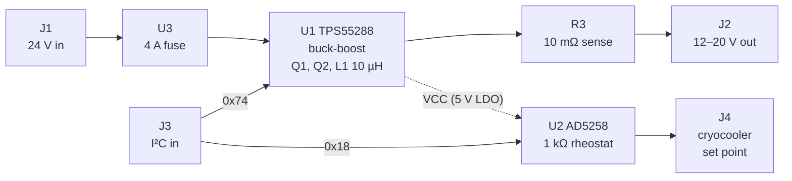

# Cryocooler Board

A 4-layer power and control board for a **Ricor K508N** cryocooler. It does two jobs, both controlled over I²C:

1. **Supplies the cryocooler's power.** A TI **TPS55288** buck-boost converter steps the 24 V rail down to an adjustable **12–20 V**.
2. **Sets the cryocooler's target temperature.** An Analog Devices **AD5258** digital potentiometer acts as the cryocooler's set-point resistor, around 170 K.


Designed in KiCad 8 by Rodrigo Spinola e Castro.

---

## Status

| Version | Tag | State |
|---|---|---|
| V1 | `v1` | First fabricated board |
| V2 | `v2` | Fabricated, faulty |
| V3 | `v3` | Fabricated. I²C and digipot work; the converter output oscillates and efficiency is very low (see [Lessons from V3](#lessons-from-v3)) |
| V4 | – | Redesign addressing V3's problems: bulk output capacitor, current limit, thermal vias. Not built |
| **V4.1** | `v4.1` | **Ordered from JLCPCB on 13 Oct 2026.** A test build to confirm the control loop is stable before space-rated parts are chosen. See [Changes in V4.1](#changes-in-v41) |

Each built version is tagged. Browse any of them with the branch/tag selector on GitHub, or compare two, e.g. `…/compare/v3...main`.

---

## Requirements

| # | Requirement |
|---|---|
| 1 | Step the 24 V rail down to a set value between **12 V and 20 V**. Expected load: up to ~2 A while cooling down, ~0.5 A at the set point. The cryocooler's maximum input power is 20 W. |
| 1a | The output must never exceed 24 V. |
| 1b | After a reset of I²C or of the 24 V supply, the output returns to **12 V**. |
| 1c | Switching noise must not interfere with the CCD electronics, so the switching frequency stays **above 500 kHz**. |
| 2 | Set the cryocooler's target temperature (around 170 K) through a variable resistor. |
| 3 | Control both the output voltage and the temperature set point over **I²C**. |
| 4 | After a reset of I²C or of power, the temperature set point returns to 170 K. |

---

## How it works



- **Power path:** 24 V enters on J1 and passes through the 4 A fuse U3. The TPS55288 drives external MOSFETs Q1 and Q2 on the input side and uses inductor L1. The output passes through the 10 mΩ sense resistor R3 to J2.
- **Control:** both chips sit on one I²C bus (J3). The bus is pulled up by the host computer (3.3 V), not by this board: R1 and R2 (2.2 kΩ to VCC) are kept as footprints but **not populated** in V4.1. This is a provisional choice; see the I²C item under [Open items](#open-items-after-v41).
  - TPS55288 at **0x74**: its MODE pin is tied to ground, which also selects the internal 5 V regulator and forced PWM at light load (datasheet Table 7-2).
  - AD5258 at **0x18**: both address pins are tied to ground.
- **VCC** is the TPS55288's internal 5 V supply, made from VIN. It powers the digipot (both VDD and VLOGIC), so **both chips only respond on I²C while 24 V is present**.
- **Grounds:** analog ground (AGND) and power ground (PGND) are separate copper and joined at one point by the net tie NT1.

### Reset behaviour (requirements 1b and 4)
- **TPS55288:** it has no non-volatile memory. After a power cycle its output is **off**, and this can't be changed. The host must re-send the I²C commands to enable the output and set 12 V.
- **AD5258:** it stores its wiper setting in EEPROM and restores it at power-up. Store the 170 K setting in EEPROM to meet requirement 4.

---

## Connectors

All connectors are Molex Pico-Lock.

| Ref | Function | Part | Pin 1 | Pin 2 | Pin 3 | Pin 4 |
|---|---|---|---|---|---|---|
| **J1** | 24 V input | 4-pin 5040500491 | VIN | VIN | PGND | PGND |
| **J2** | Converter output to the cryocooler | 2-pin 2053380002 | VOUT | PGND | – | – |
| **J3** | I²C | 4-pin 5040500491 | AGND | SCL | SDA | AGND |
| **J4** | Cryocooler temperature set point | 2-pin 2053380002 | CRYO_2 | CRYO_1 | – | – |

On J1, each signal uses two pins in parallel.

Test points: TP_VIN1, TP_VOUT1, TP_PGND1, TP_AGND1, TP_SCL1, TP_SDA1, plus **TP_COMP1** (error-amplifier output) and **TP_VCC1** (gate-drive supply), new in V4.1. SW1 can be probed at the uncovered via at (129.5, 87.9) mm, on the SW1 copper beside L1; see [Bring-up notes](#bring-up-notes).

**J1 and J3 are the same 4-pin part, and J2 and J4 are the same 2-pin part.** A swapped harness puts 24 V on the I²C lines, or the converter output across the digipot. Label harnesses and check every plug before applying power.

---

## Design choices

### Converter: TPS55288 ([datasheet](https://www.ti.com/product/TPS55288))

**Why this chip:**
- 2.7–36 V input covers the 24 V rail.
- 0.8–22 V output covers 12–20 V.
- 6.35 A current limit, programmable over I²C.
- 200 kHz–2.2 MHz switching, with optional frequency dithering.
- Built-in 5 V supply for the I²C devices.

**Drawbacks:**
- The 5 V supply is inefficient when made from 24 V, so it adds some heat.
- The settings don't survive a power cycle (see above).

| Function | Parts | Value | Reasoning |
|---|---|---|---|
| Switching frequency | Rfsw1 | 32.4 kΩ → **≈610 kHz** (datasheet Eq. 3) | Above the 500 kHz CCD limit even at the low end of tolerance with dithering (≈510 kHz), but as close as practical to the chip's typical 400 kHz |
| Inductor | L1 | **10 µH**, Coilcraft XAL1010-103MED (JLC C6358489) | Gives ≈1 A ripple at the worst case (12 V out from 24 V in). The chip supports 1–10 µH; TI's evaluation board uses 4.7 µH with 3.2 A ripple at 400 kHz |
| Input-voltage turn-on | R4 / R5, C10 = 100 nF | 30 kΩ / 5.1 kΩ | Turns the converter on at ≈8 V; 24 V gives ≈3.4 V on the EN pin (limit 20 V). C10 filters the EN pin |
| Frequency dithering | Cdith1, R9 | 15 nF → **≈735 Hz** modulation | Spreads switching noise over ±7 % of the frequency. R9 is an unpopulated 0 Ω across Cdith1: fit it to turn dithering off for an A/B test |
| Input fuse | U3 | 4 A, 72 V, 1206: prosemi 1206TD-4A (JLC C2838918) on the Bel C1T (0685T4000-01) footprint | Protects the 24 V bus. More than twice the expected 1–2 A, and well above the cryocooler's 20 W. Can be swapped for a jumper |
| Input capacitors | CIN1, CIN2, CIN4, CIN3 | 2 × 10 µF + 1 µF ceramic, plus 68 µF bulk | Datasheet recommends ~21 µF ceramic, plus bulk if the supply is far away; layout copied from TI's evaluation board |
| Output capacitors | C3–C6, C7, C11 | 4 × 10 µF (Samsung CL31A106KBHNNNE, 50 V X5R) + 1 µF ceramic, plus **68 µF hybrid** (Panasonic EEH-ZA1V680XP) | ≈80 µF effective at 12 V and ≈74 µF at 20 V, because the ceramics lose most of their capacitance under DC bias. The compensation is designed for this. C11 is new in V4 |
| Boot capacitors | C1, C2 | 0.1 µF | As on TI's evaluation board |
| Input-side MOSFETs | Q1, Q2 | Infineon IPZ40N04S5L4R8ATMA1, with 1 Ω gate resistors R7 and R8 | As on TI's evaluation board. The 40 A rating is far more than needed. In V4.1, R7 sits next to Q1's gate, as TI's layout guide asks |
| Loop compensation | Rc1, Cc1, Cp1 | 26.1 kΩ, 5.6 nF C0G, **100 pF** C0G | From the datasheet's Eqs. 24–26 with C11 fitted (C11 ESR ≈35 mΩ gives Cp ≈93 pF). TI's calculator gives crossover ≈11 kHz, 72° phase margin, 13.8 dB gain margin at 12 V out, and ≈13 kHz, 66°, 9.7 dB at 20 V out (plot below); calculated, not yet measured |
| Output current limit | R3, C12 | 10 mΩ, 1 W; 0.1 µF across it | Register 02h set to 30 mV gives a **3 A** limit. C12 filters the sense lines, like C13 on TI's evaluation board. The sense point at ISP includes some output copper, so the limit may trip nearer 2.7 A |
| Average inductor current limit | R6 | 41.2 kΩ → **8 A** (≈5.8 A at the low tolerance) | Well above the ≈2.75 A peak inductor current, below the inductor's saturation and the chip's switch limits. Keeps an unstable loop from damaging the board |
| I²C address | MODE pin to AGND | 0x74 | Operating mode and VCC source can then be changed over I²C |
| VCC | CVCC1, C8, C9 | 4.7 µF + 1 µF + 0.1 µF | As on TI's evaluation board (CVCC1 is the same part as its C14). CVCC1 returns to AGND, per the datasheet pin table |


*Open-loop response from TI's TPS55288 design calculator with the V4.1 values, at 24 V in, 2 A, 605 kHz. Effective ceramic output capacitance is taken from the V3 DC-bias measurement (≈12.4 µF at 12 V, ≈6.5 µF at 20 V). At 20 V the gain margin (9.7 dB) is just under TI's 10 dB guidance.*

### Temperature set point: AD5258 ([datasheet](https://www.analog.com/en/products/ad5258.html))
- **AD5258BRMZ1:** 1 kΩ full scale in 64 steps (≈16 Ω per step), I²C, and EEPROM to restore the setting at power-up.
- **Wired as a rheostat:** the wiper W is tied to terminal A, which goes to CRYO_1. The resistance the cryocooler sees is between W and B (CRYO_2), on J4.
- **Address:** both address pins are tied to ground, giving **0x18**.

---

## Lessons from V3

On V3, I²C and the digipot worked; the digipot covers its full 1 kΩ range. The converter did not:

- **The output oscillated by several volts at ~30 kHz** around the set value. At 10 V into 160 Ω, the scope below shows about 4.5 V peak-to-peak.
- **Efficiency was ≈20 %**, against an expected 90–95 %.
- **The board ran very hot** at outputs above 16 V. At lower switching frequencies it was even less stable and failed above 17 V.


**Cause:** the compensation is designed for about 100 µF of output capacitance, ceramic plus electrolytic. V3 had only about 41 µF, all ceramic, and ceramic capacitors lose much of their capacitance at higher voltages. Measuring how the output decayed after setting 12 V showed **≈20 µF at 8–12 V** and the full 41 µF only below 8 V. With so much less capacitance than planned, the control loop was unstable.

**Changes in V4:**
- Added the 68 µF bulk output capacitor C11, bringing the nominal total to ≈109 µF (≈74–80 µF effective under DC bias).
- Extended the chip's VOUT copper pour to include C11.
- Added vias on the TPS55288 PGND pad to carry heat into the ground planes.
- Set an average inductor current limit, so an unstable loop can't damage the board.

### Changes in V4.1

V4.1 is built to answer one question: is the loop stable with the bulk capacitor fitted? Changes that only matter in space (space-rated capacitors, vacuum heat path) wait until it is.

**Values and parts**
- Cp1 22 pF → **100 pF C0G**, recalculated for C11 (ESR ≈35 mΩ).
- Cc1 changed to a **C0G** part. V3's part (C1628) was X7R ±10%.
- R6 → **41.2 kΩ** (8 A average current limit).
- R5 → **5.1 kΩ**; R4 30 kΩ; Rfsw1 32.4 kΩ; Cdith1 **15 nF**.
- Q1/Q2 symbol corrected to IPZ40N04S5L4R8ATMA1, the part on the footprint and on TI's evaluation board.
- R1/R2 (I²C pull-ups) not populated; the 3.3 V host pulls the bus up.
- J2 (output) is a 2-pin Pico-Lock; JLC lists it at 6.5 A, ample for 2 A.

**Additions**
- **C12**, 0.1 µF across the current-sense resistor.
- **R9**, an unpopulated 0 Ω across Cdith1, to switch dithering off.
- Test points **TP_COMP1** and **TP_VCC1**, and an uncovered SW1 via for probing.

**Layout**
- **R7 moved next to Q1's gate** (it was 12 mm away). The gate and its return still run on separate inner-layer traces about 3.75 mm apart, not as a pair.
- Every resistor and capacitor moved to KiCad's standard IPC footprints (0603/0805/1206). Two of the old vendor 0603 land patterns had pads too far apart for the part.
- C5 and C6 connect solidly to the top PGND pour.
- Floating copper removed; DRC clean apart from silkscreen warnings.

**Schematic housekeeping**
- Every assembled part has `MF`, `MP` and `LCSC Part #` fields. The `MP` is the part the LCSC number actually places, which for several V3 parts differs from the old footprint names.
- ERC fixes: PWR_FLAGs on VIN, PGND and AGND; pin types corrected on the custom symbols (U1 ISP → input, VCC → power output; connectors and fuse → passive; AD5258 pins typed).
- Title block and silkscreen set to V4.1.

---

## PCB

**4 layers, 1.6 mm thick, 58 × 49 mm,** with four M3 mounting holes. The stackup follows TI's evaluation board.

| Layer | Use |
|---|---|
| Top (F.Cu) | Components; copper pour mostly PGND, plus VOUT |
| In1 | PGND plane |
| In2 | Power: VCC, AGND, VIN |
| Bottom (B.Cu) | PGND plane |

| Top | In1: PGND |
|---|---|
|  |  |
| **In2: power** | **Bottom: PGND** |
|  |  |

These images show V4.1 as ordered: each copper layer with the front silkscreen on top.

---

## Repository layout

```
cryocooler-board/
├── cryocooler-board.kicad_pro / .kicad_sch / .kicad_pcb   KiCad 8 project
├── sym-lib-table, fp-lib-table                            point at lib/ (project-relative)
├── lib/
│   ├── Cryocooler.kicad_sym     custom symbols
│   ├── Cryocooler.pretty/       custom footprints
│   └── Cryocooler.3dshapes/     3D models (STEP)
├── production/                  JLCPCB files: Gerbers zip, BOM, pick-and-place
├── docs/                        switching-converter design primer, README images
└── scripts/sw1_duty_analysis.py analyse SW1 duty cycle and efficiency from scope CSVs
```

**Opening it:** clone or download, then open `cryocooler-board.kicad_pro` in **KiCad 8**. Every non-standard symbol, footprint and 3D model is in `lib/`, so there's nothing to install. The tags `v1`–`v3` hold the old versions, but those used symbol libraries stored outside the project, so they may open with library warnings.

**Scope analysis script:**
```
python3 scripts/sw1_duty_analysis.py scope.csv --rload 176 --vin 24
```

---

## Manufacturing

Boards are made and assembled by **JLCPCB**. The production files are generated with the KiCad [Fabrication Toolkit](https://github.com/bennymeg/JLC-Plugin-for-KiCad) into `production/`.

- Give each assembled part an `LCSC Part #` field in the schematic, so the BOM names the exact JLC part. Also fill `MF` and `MP` with the part that LCSC number places.
- Resistors and capacitors use KiCad's standard footprints (`Resistor_SMD:R_0603_1608Metric` and so on). Only parts with their own package have custom footprints in `lib/`.
- The toolkit settings are in `fabrication-toolkit-options.json`: exclude DNP parts, refill zones, apply JLC rotation corrections.
- **Vias are deliberately left uncovered** so they can be used as probe points. Leave via covering as in the files when ordering.
- **Check rotations in JLC's placement view.** The toolkit only corrects standard footprints. In the V4.1 preview, U2, Q1 and Q2 (custom footprints) appeared rotated and had to be fixed by hand. To make it automatic, add a `JLCPCB Rotation Offset` field to those symbols.
- **Confirm every BOM line in JLC's tool.** In V4.1 the 10 µF ceramics, the hybrids and the 1 µF ceramics came back as "Unconfirmed" with quantity 0 until confirmed.
- 4 layers, 1.6 mm. Six vias use 0.15 mm drills (as on V3).
- The exact files sent for each order are attached to that version's GitHub Release.

---

## Bring-up notes

- **Power up from a current-limited supply (about 0.3 A at first), ramping the voltage up.** There is no reverse-polarity or surge protection. A hot-plug onto a live 24 V supply is estimated to overshoot to about 32 V with 1 m of leads, under the 35 V and 40 V ratings but not by much.
- **Check every plug before applying power** (J1/J3 and J2/J4 are look-alikes).
- **SW1:** probe the uncovered via at (129.5, 87.9) mm. The vias around it are **VIN**, not ground: never put a probe ground on them. Use a short ground lead to a PGND point. The via labelled "SW1" on the silkscreen is on the gate-return trace and also shows gate-drive spikes.
- **COMP (TP_COMP1):** use a 10× probe. A 1× probe (~100 pF) roughly doubles Cp1.
- **I²C ground is AGND.** If the I²C adapter's ground and the bench supply's negative are both earthed, part of the return current flows through AGND and NT1. Float the supply or use an isolated adapter.
- **Do not connect J4 to the K508N until its set-point input is known.** The AD5258 allows ±5 mA continuous through its terminals, which must stay between GND and VDD. At low codes its resistance is ≈75 Ω, so a set-point node above ≈0.4 V could overload it. Clamp the minimum code in firmware.

---

## Open items after V4.1

Carried to the test board and the flight design:

- [ ] **AD5258 / K508N set point:** measure the voltage and source impedance of the cryocooler's set-point input before connecting J4 (see [Bring-up notes](#bring-up-notes)).
- [ ] **High-side gate drive:** route DR1H and its SW1 return as a pair, and Kelvin-connect the return at Q1's source (TI layout guide §2.3).
- [ ] **Input switching loop:** add PGND vias at Q2's source and at the input capacitors' ground pads, and connect those pads solidly.
- [ ] **Current-sense routing:** take ISP from R3's pad as a pair with ISN, and put C12 at the IC.
- [ ] **CVCC1 ground:** AGND (datasheet pin table, current design) or PGND (TI layout guide §2.3). Try both on the test board.
- [ ] **Heat path for vacuum:** thermal vias on U1's PGND and VOUT pads, and 2 oz copper.
- [ ] **Mounting holes:** PGND copper reaches within 0.25 mm of the holes, under the screw heads. Decide whether PGND may touch the structure.
- [ ] **CIN3 and C11** are 35 V parts on a 24 V rail; confirm the bus maximum and its transients (TI's evaluation board uses 50 V on the input).
- [ ] **Connectors:** use different connectors or pin counts for J1/J3 and J2/J4, and relabel J4 (silkscreen says "Cryo out") as the set point.
- [ ] **JLC rotations:** add `JLCPCB Rotation Offset` to U2, Q1 and Q2.
- [ ] Remove the now-unused vendor passive footprints from `lib/Cryocooler.pretty/`, and update the silkscreen note "Local I2C Power, 2.2 Kohm" (R1/R2 are not populated).
- [ ] Space-rated capacitors (EEE-INST-002 derating), after the loop is shown stable.
- [ ] **I²C interface with a 3.3 V host (provisional: R1/R2 DNP).** The host drives the bus at 3.3 V with its own pull-ups. With R1/R2 populated, the 2.2 kΩ pull-ups to VCC (5.2 V) push the host's pins above its supply, so for now R1/R2 are not populated. A separate test setup confirmed both chips work this way. This matches TI's evaluation board, where the 2.2 kΩ pull-ups to VCC are optional (jumpers J5/J6) and the 3.3 V USB2ANY adapter supplies its own. Two problems remain before this is final:
  - **AD5258 input-high threshold.** Its logic supply (VLOGIC, pin 6) is tied to VCC, so it needs SCL/SDA high ≥ 0.7 × 5.2 V = **3.64 V**. A 3.3 V bus is 0.34 V short of the guaranteed level; it works in testing, but with no specified margin across temperature or parts. The TPS55288 needs only 1.2 V and is within spec. TI's evaluation board has no AD5258, so it doesn't cover this.
  - **Bus powered while 24 V is off.** VCC is then 0 V, so the host's pull-ups hold SCL/SDA above the TPS55288's VCC + 0.3 V rating and push current through the AD5258's clamp diodes into VCC (limited by the host's pull-ups; well under 1 mA).
  - **Options:** (a) keep R1/R2 DNP and accept the AD5258 margin, verifying the digipot in TVAC; (b) feed VLOGIC from a small on-board 3.3 V LDO, which brings the threshold to 2.31 V without changing J3; (c) add a level translator (PCA9306 type) with R1/R2 back as 5 V-side pull-ups, which also isolates the bus when 24 V is off but needs the host's 3.3 V on J3. Whichever is chosen, the host should keep the bus idle until 24 V is present.
