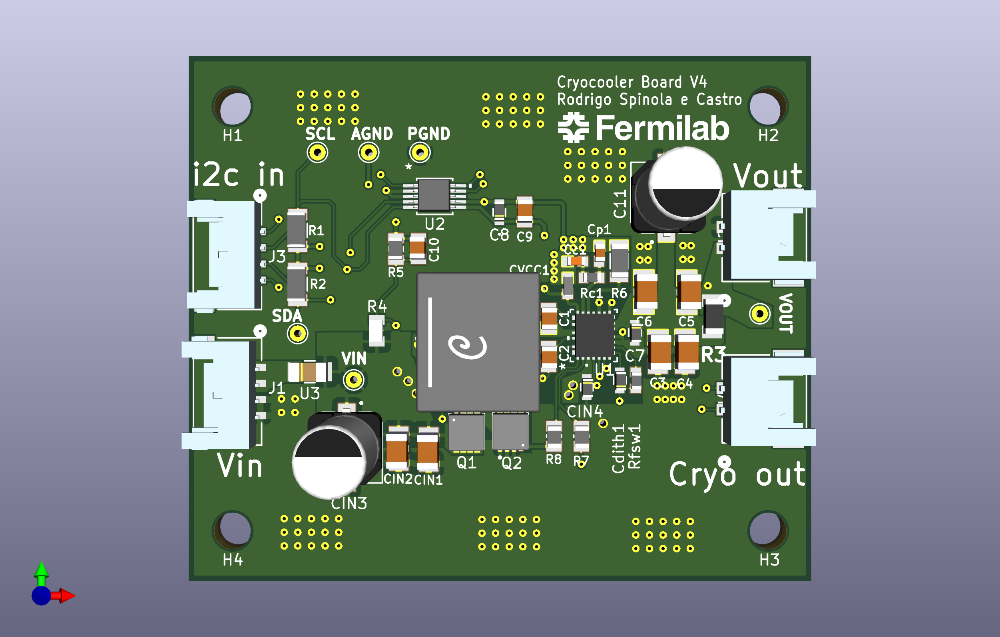
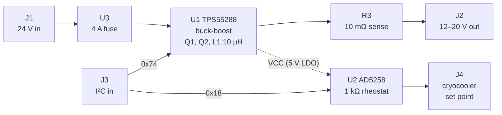
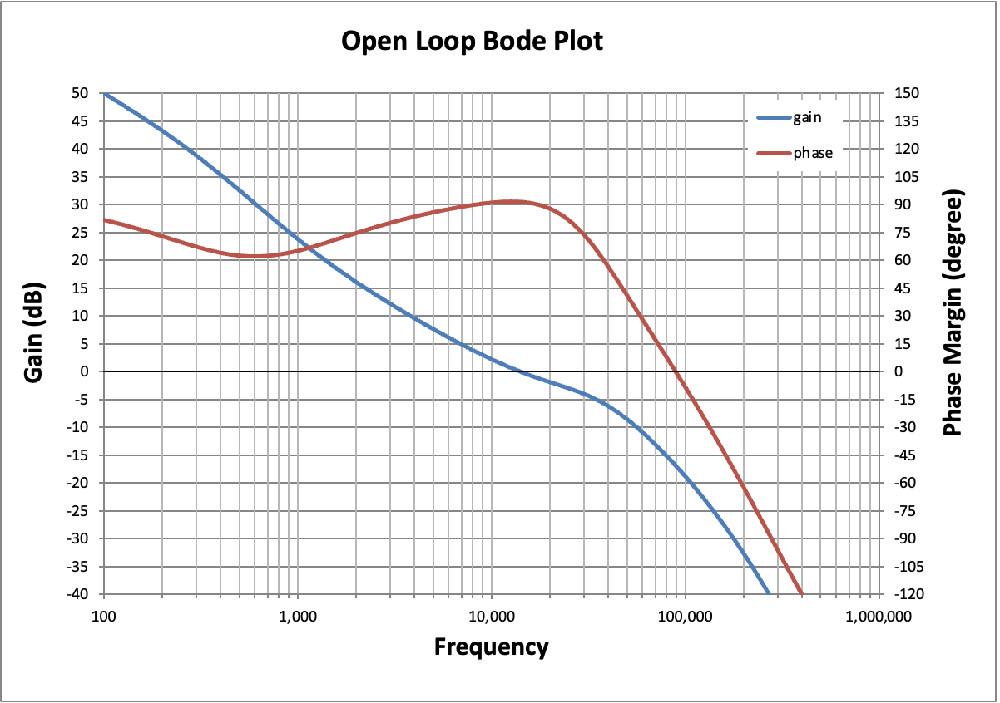
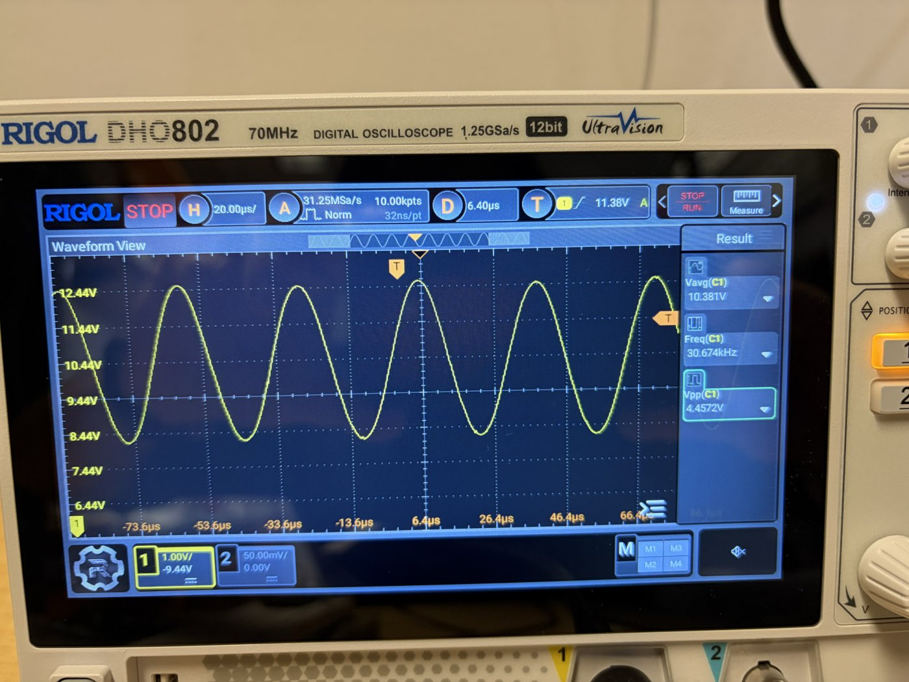
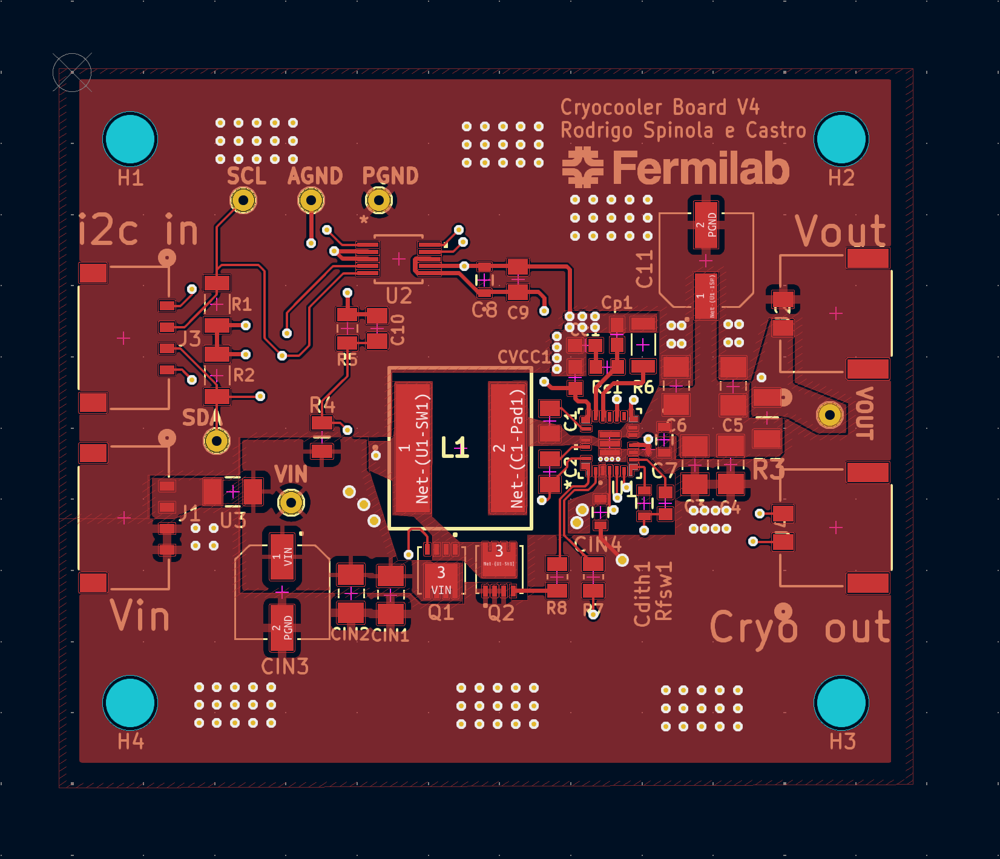
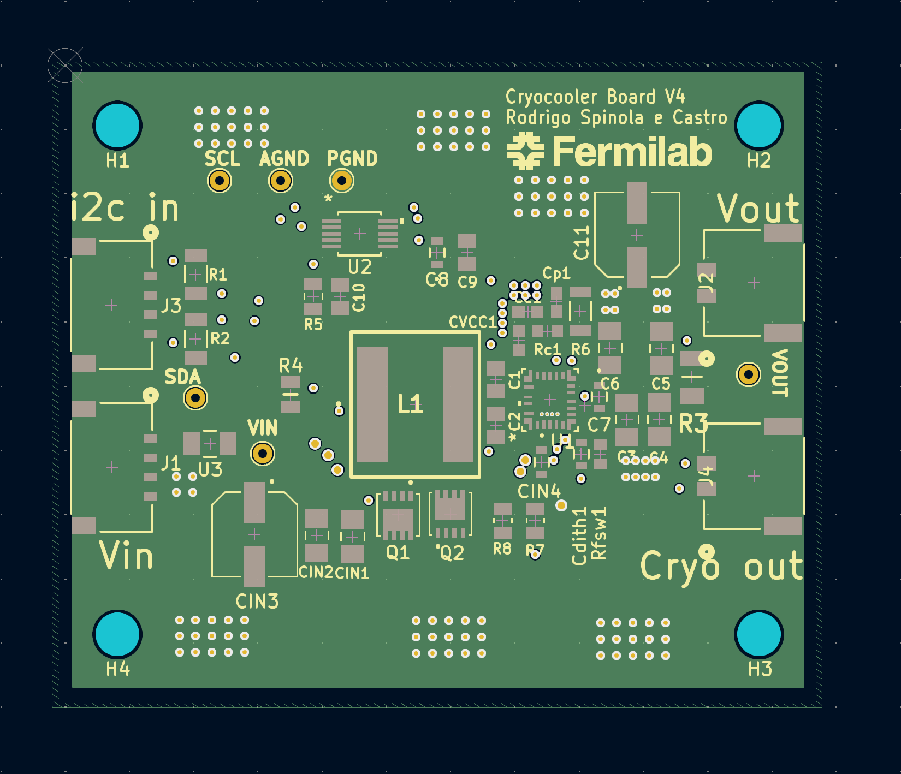
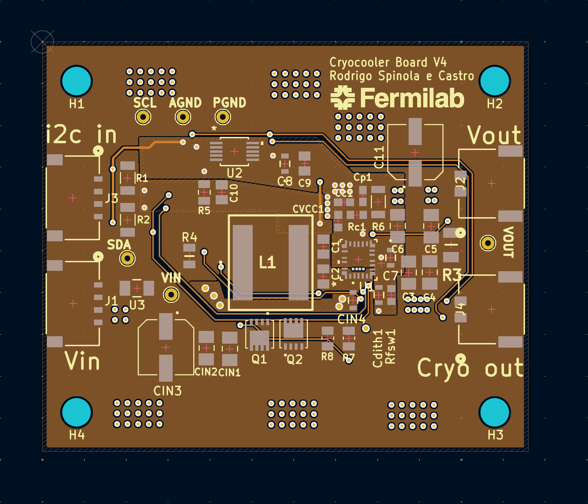
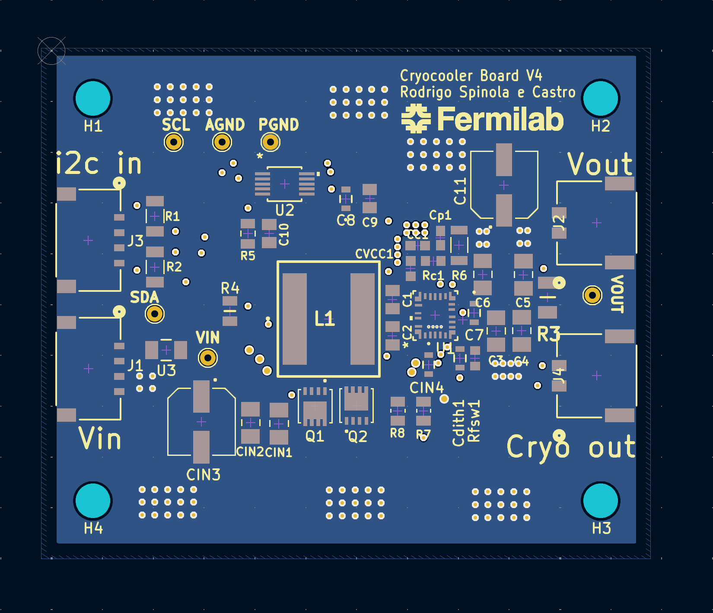

# Cryocooler Board

A 4-layer power and control board for a **Ricor K508N** cryocooler. It does two jobs, both controlled over I²C:

1. **Supplies the cryocooler's power.** A TI **TPS55288** buck-boost converter steps the 24 V rail down to an adjustable **12–20 V**.
2. **Sets the cryocooler's target temperature.** An Analog Devices **AD5258** digital potentiometer acts as the cryocooler's set-point resistor, around 170 K.



Designed in KiCad 8 by Rodrigo Spinola e Castro.

---

## Status

| Version | Tag | State |
|---|---|---|
| V1 | `v1` | First fabricated board |
| V2 | `v2` | Fabricated, faulty |
| V3 | `v3` | Fabricated. I²C and digipot work; the converter output oscillates and efficiency is very low (see [Lessons from V3](#lessons-from-v3)) |
| V4 | – | Redesign addressing V3's problems: bulk output capacitor, current limit, thermal vias |
| **V4.1** | – (tagged at order) | **Current design, about to go to production.** Compared with V4: the output connector J2 is now a 2-pin Pico-Lock instead of a 4-pin. (J4 was briefly changed to 4-pin during V4.1 and then returned to 2-pin.) |

Each built version is tagged. Browse any of them with the branch/tag selector on GitHub, or compare two, e.g. `…/compare/v3...main`.

---

## Requirements

| # | Requirement |
|---|---|
| 1 | Step the 24 V rail down to a set value between **12 V and 20 V**. Expected load: up to ~2 A while cooling down, ~0.5 A at the set point. The cryocooler's maximum input power is 20 W. |
| 1a | The output must never exceed 24 V. |
| 1b | After a reset of I²C or of the 24 V supply, the output returns to **12 V**. |
| 1c | Switching noise must not interfere with the CCD electronics, so the switching frequency stays **above 500 kHz**. |
| 2 | Set the cryocooler's target temperature (around 170 K) through a variable resistor. |
| 3 | Control both the output voltage and the temperature set point over **I²C**. |
| 4 | After a reset of I²C or of power, the temperature set point returns to 170 K. |

---

## How it works



- **Power path:** 24 V enters on J1 and passes through the 4 A fuse U3. The TPS55288 drives external MOSFETs Q1 and Q2 on the input side and uses inductor L1. The output passes through the 10 mΩ sense resistor R3 to J2.
- **Control:** both chips sit on one I²C bus (J3), pulled up to VCC with 2.2 kΩ (R1, R2).
  - TPS55288 at **0x74**: its MODE pin is tied to ground.
  - AD5258 at **0x18**: both address pins are tied to ground.
- **VCC** is the TPS55288's internal 5 V supply, made from VIN. It powers the digipot and the I²C pull-ups, so **both chips only respond on I²C while 24 V is present**.
- **Grounds:** analog ground (AGND) and power ground (PGND) are separate copper and joined at one point by the net tie NT1.

### Reset behaviour (requirements 1b and 4)
- **TPS55288:** it has no non-volatile memory. After a power cycle its output is **off**, and this can't be changed. The host must re-send the I²C commands to enable the output and set 12 V.
- **AD5258:** it stores its wiper setting in EEPROM and restores it at power-up. Store the 170 K setting in EEPROM to meet requirement 4.

---

## Connectors

All connectors are Molex Pico-Lock.

| Ref | Function | Part | Pin 1 | Pin 2 | Pin 3 | Pin 4 |
|---|---|---|---|---|---|---|
| **J1** | 24 V input | 4-pin 5040500491 | VIN | VIN | PGND | PGND |
| **J2** | Converter output to the cryocooler | 2-pin 2053380002 | VOUT | PGND | – | – |
| **J3** | I²C | 4-pin 5040500491 | AGND | SCL | SDA | AGND |
| **J4** | Cryocooler temperature set point | 2-pin 2053380002 | CRYO_2 | CRYO_1 | – | – |

On J1, each signal uses two pins in parallel.

Test points: TP_VIN1, TP_VOUT1, TP_PGND1, TP_AGND1, TP_SCL1 and TP_SDA1.

---

## Design choices

### Converter: TPS55288 ([datasheet](https://www.ti.com/product/TPS55288))

**Why this chip:**
- 2.7–36 V input covers the 24 V rail.
- 0.8–22 V output covers 12–20 V.
- 6.35 A current limit, programmable over I²C.
- 200 kHz–2.2 MHz switching, with optional frequency dithering.
- Built-in 5 V supply for the I²C devices.

**Drawbacks:**
- The 5 V supply is inefficient when made from 24 V, so it adds some heat.
- The settings don't survive a power cycle (see above).

| Function | Parts | Value | Reasoning |
|---|---|---|---|
| Switching frequency | Rfsw1 | 32.4 kΩ → **≈605 kHz** | Above the 500 kHz CCD limit, but as close as practical to the chip's typical 400 kHz |
| Inductor | L1 | **10 µH**, Coilcraft XAL1010-103MED (JLC C6358489) | Gives ≈1 A ripple at the worst case (12 V out from 24 V in). The chip supports 1–10 µH; TI's evaluation board uses 4.7 µH with 3.2 A ripple at 400 kHz |
| Input-voltage turn-on | R4 / R5, C10 = 100 nF | 30 kΩ / 5.1 kΩ | Turns the converter on at ≈8 V; 24 V gives ≈3.4 V on the EN pin (limit 20 V). C10 filters the EN pin |
| Frequency dithering | Cdith1 | see [Open items](#open-items-before-ordering-v41) | Spreads switching noise over ±7 % of the frequency. The design review chose 47 nF (≈759 Hz modulation). Can be replaced with a short to turn dithering off |
| Input fuse | U3 | 4 A, Bel Fuse C1T (0685T4000-01), 1206 | Protects the 24 V bus. More than twice the expected 1–2 A, and well above the cryocooler's 20 W. Can be swapped for a jumper |
| Input capacitors | CIN1, CIN2, CIN4, CIN3 | 2 × 10 µF + 1 µF ceramic, plus 68 µF bulk | Datasheet recommends ~21 µF ceramic, plus bulk if the supply is far away; layout copied from TI's evaluation board |
| Output capacitors | C3–C6, C7, C11 | 4 × 10 µF + 1 µF ceramic, plus **68 µF bulk** | ≈109 µF in total, close to the 100 µF the compensation is designed for. C11 is new in V4 |
| Boot capacitors | C1, C2 | 0.1 µF | As on TI's evaluation board |
| Input-side MOSFETs | Q1, Q2 | Infineon IPZ40N04S5, with 1 Ω gate resistors R7 and R8 | As on TI's evaluation board. The 40 A rating is far more than needed |
| Loop compensation | Rc1, Cc1, Cp1 | 26.1 kΩ, 5.6 nF, 22 pF | From TI's design calculator (see the Bode plot below) |
| Current sense | R3 | 10 mΩ, 1 W | Not actively used, but costs nothing to have |
| Average inductor current limit | R6 | see [Open items](#open-items-before-ordering-v41) | Target ≈10 A: above any normal operating current, below the inductor's 17.5 A and the chip's 16 A switch limits. Keeps an unstable loop from damaging the board |
| I²C address | MODE pin to AGND | 0x74 | Operating mode and VCC source can then be changed over I²C |
| VCC | CVCC1, C8, C9 | 4.7 µF + 1 µF + 0.1 µF | As on TI's evaluation board |



### Temperature set point: AD5258 ([datasheet](https://www.analog.com/en/products/ad5258.html))
- **AD5258BRMZ1:** 1 kΩ full scale in 64 steps (≈16 Ω per step), I²C, and EEPROM to restore the setting at power-up.
- **Wired as a rheostat:** the wiper W is tied to terminal A, which goes to CRYO_1. The resistance the cryocooler sees is between W and B (CRYO_2), on J4.
- **Address:** both address pins are tied to ground, giving **0x18**.

---

## Lessons from V3

On V3, I²C and the digipot worked; the digipot covers its full 1 kΩ range. The converter did not:

- **The output oscillated by several volts at ~30 kHz** around the set value. At 10 V into 160 Ω, the scope below shows about 4.5 V peak-to-peak.
- **Efficiency was ≈20 %**, against an expected 90–95 %.
- **The board ran very hot** at outputs above 16 V. At lower switching frequencies it was even less stable and failed above 17 V.



**Cause:** the compensation is designed for about 100 µF of output capacitance, ceramic plus electrolytic. V3 had only about 41 µF, all ceramic, and ceramic capacitors lose much of their capacitance at higher voltages. Measuring how the output decayed after setting 12 V showed **≈20 µF at 8–12 V** and the full 41 µF only below 8 V. With so much less capacitance than planned, the control loop was unstable.

**Changes in V4:**
- Added the 68 µF bulk output capacitor C11, bringing the total to ≈109 µF.
- Extended the chip's VOUT copper pour to include C11.
- Added vias on the TPS55288 PGND pad to carry heat into the ground planes.
- Set an average inductor current limit, so an unstable loop can't damage the board.

---

## PCB

**4 layers, 1.6 mm thick, 58 × 49 mm,** with four M3 mounting holes. The stackup follows TI's evaluation board.

| Layer | Use |
|---|---|
| Top (F.Cu) | Components; copper pour mostly PGND, plus VOUT |
| In1 | PGND plane |
| In2 | Power: VCC, AGND, VIN |
| Bottom (B.Cu) | PGND plane |

| Top | In1: PGND |
|---|---|
|  |  |
| **In2: power** | **Bottom: PGND** |
|  |  |

These images show V4.1: each copper layer with the front silkscreen on top.

---

## Repository layout

```
cryocooler-board/
├── cryocooler-board.kicad_pro / .kicad_sch / .kicad_pcb   KiCad 8 project
├── sym-lib-table, fp-lib-table                            point at lib/ (project-relative)
├── lib/
│   ├── Cryocooler.kicad_sym     custom symbols
│   ├── Cryocooler.pretty/       custom footprints
│   └── Cryocooler.3dshapes/     3D models (STEP)
├── production/                  JLCPCB files: Gerbers zip, BOM, pick-and-place
├── docs/                        switching-converter design primer, README images
└── scripts/sw1_duty_analysis.py analyse SW1 duty cycle and efficiency from scope CSVs
```

**Opening it:** clone or download, then open `cryocooler-board.kicad_pro` in **KiCad 8**. Every non-standard symbol, footprint and 3D model is in `lib/`, so there's nothing to install. The tags `v1`–`v3` hold the old versions, but those used symbol libraries stored outside the project, so they may open with library warnings.

**Scope analysis script:**
```
python3 scripts/sw1_duty_analysis.py scope.csv --rload 176 --vin 24
```

---

## Manufacturing

Boards are made and assembled by **JLCPCB**. The production files are generated with the KiCad [Fabrication Toolkit](https://github.com/bennymeg/JLC-Plugin-for-KiCad) into `production/`.

- Give each assembled part an `LCSC Part #` field in the schematic, so the BOM names the exact JLC part.
- The exact files sent for each order are attached to that version's GitHub Release.

---

## Open items before ordering V4.1

- [ ] **Cdith1:** the schematic and PCB say 15 nF; the part and footprint are the 47 nF CGA3E2X7R1H473K080AD, and the design review chose 47 nF. Decide, and match the part.
- [ ] **J2 (output):** confirm that the 2-pin Pico-Lock's current rating per contact covers the ~2 A peak load. The old 4-pin connector split the current across two pins.
- [ ] **Silkscreen:** the board text still says "Cryocooler Board V4"; change it to V4.1.
- [ ] **J2 and J4 Value fields:** both connectors are 2-pin now; make sure each Value says "MOL Pico 2" so the BOM lists the right part.
- [ ] **R6 (current limit):** the schematic value is 40 kΩ, the footprint is a 20 kΩ part, and the design review calculated 47.5 kΩ for 10 A. Decide, and match the part.
- [ ] **Q1/Q2:** the symbol says IPZ40N04S5-3R1, the footprint says IPZ40N04S5L4R8ATMA1. Pick the part being ordered.
- [ ] **Resistor values vs footprint names:** R4 (30 k on a 30.9 k footprint), R5 (5 k in the schematic vs 5.1 k in the review, on a 2.00 k footprint) and Rfsw1 (32.4 k on a 10.0 k footprint). Footprint names come from vendor parts; only the package matters, so make sure `LCSC Part #` names the right value.
- [ ] Add `LCSC Part #` to all assembled parts. L1 = C6358489 is done.
- [ ] CIN3 and C11 are 35 V parts on a 24 V rail; decide whether that's enough headroom.
- [ ] ERC: add PWR_FLAGs on the VIN and ground nets, and change "Unspecified" pin types on the vendor symbols to Passive or Input.
- [ ] Set the schematic title block revision to V4.1.
